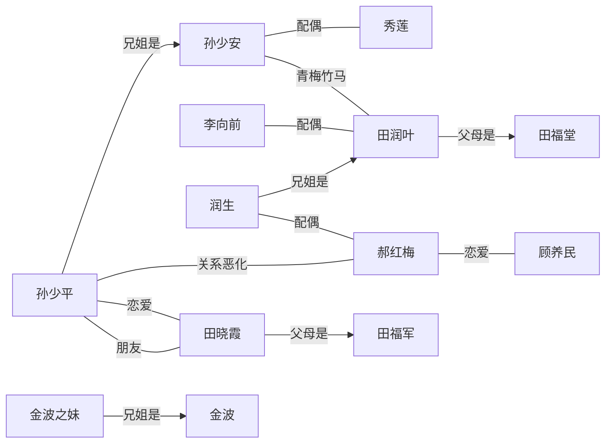

# 《平凡的世界》实体、关系与知识图谱实验

## 一、语料与评价约定

三张图逐句转录为 21 句，共 1103 个正文字符。另按图文逐句编制参考标注，含 92 个实体提及、60 条带证据关系；没有独立第二标注者复核。21 句全部用于本次对照，模型的监督训练另用脚本生成的 896 条短句（27 种关系及无关系各 32 条）。词典与规则据此题材设计，因此属于小语料、已知领域的课堂比较。

实体采用平面 BIO 标注，按〔句号、字符起点、终点、类型〕完全一致计命中。人物涵盖具名人物及“金波之妹”一类可唯一指认的称谓；机构、地点、身份、事件、制度、疾病和时间限于词典所述范围。年龄、金额、泛称亲属与未命名地点暂不计入目标。身份保留中心词，例如“优秀工人”标作“工人”。

关系采用 27 类限定谓词，按〔句号、规范主语、谓词、规范宾语〕计命中。同一句重复陈述只计一次，不同句可为同一边提供不同证据。配偶、恋爱、同学、朋友、青梅竹马、关系恶化按无向语义去重；单方爱慕、帮助和亲属方向单独计分。父母是、兄姐是由晚辈或弟妹指向父母或兄姐。不同时间部别并存，不推出永久有效。

P＝命中/预测；R＝命中/参考；微平均 F1＝2×命中/(预测+参考)。表中的推理耗时为三部合计；本地模型计入请求及加载，神经模型的训练耗时另列。BERT 两项任务共享一次联合训练，两个表中的训练时间是同一次计时。不同程序可能同期占用电脑，耗时只反映这一轮运行。

本次运行使用 Windows、本地 Ollama（qwen2.5:7b）、PyTorch 2.5.1、Transformers 4.44.2、spaCy 3.7.5 和 Neo4j Community 5.26.0。BERT 和 BiLSTM-CRF 使用 CPU；本机显卡为 NVIDIA GeForce RTX 4060 Laptop GPU。

## 二、实体抽取

| 方法 | 预测 | 参考 | 命中 | 精确率 | 召回率 | F1 | 三部推理耗时/s | 训练耗时/s |
| --- | --- | --- | --- | --- | --- | --- | --- | --- |
| 中文 BERT（RBT3） | 131 | 92 | 76 | 58.0% | 82.6% | 68.2% | 1.857 | 265.31 |
| 本地 Qwen2.5 7B | 93 | 92 | 59 | 63.4% | 64.1% | 63.8% | 485.032 | — |
| BiLSTM-CRF | 162 | 92 | 13 | 8.0% | 14.1% | 10.2% | 0.289 | 12.87 |

| 方法 | 第一部 F1 | 第二部 F1 | 第三部 F1 |
| --- | --- | --- | --- |
| 中文 BERT（RBT3） | 68.4% | 55.9% | 78.9% |
| 本地 Qwen2.5 7B | 65.3% | 61.1% | 65.6% |
| BiLSTM-CRF | 10.1% | 9.4% | 11.1% |

**中文 BERT（RBT3）**　多报 55 条，漏报 16 条。多报示例：1.01「1975年」时间 [0,5)；1.01「农民」身份 [6,8)；1.01「原」机构 [14,15)。漏报示例：1.01「1975年初」时间 [0,6)；1.01「农民子弟」身份 [6,10)；1.01「原西县高中」机构 [14,19)。

**本地 Qwen2.5 7B**　多报 34 条，漏报 33 条。多报示例：2.01「十一届三中全会」制度 [7,14)；2.01「支部会」机构 [32,35)；2.01「全村」地点 [60,62)。漏报示例：1.01「1975年初」时间 [0,6)；1.01「农民子弟」身份 [6,10)；1.02「教师」身份 [15,17)。

**BiLSTM-CRF**　多报 149 条，漏报 79 条。多报示例：1.01「农」身份 [6,7)；1.01「子」人物 [8,9)；1.01「平」人物 [12,13)。漏报示例：1.01「农民子弟」身份 [6,10)；1.01「孙少平」人物 [10,13)；1.01「原西县高中」机构 [14,19)。

## 三、关系抽取

| 方法 | 预测 | 参考 | 命中 | 精确率 | 召回率 | F1 | 三部推理耗时/s | 训练耗时/s |
| --- | --- | --- | --- | --- | --- | --- | --- | --- |
| spaCy 中文规则 | 23 | 60 | 21 | 91.3% | 35.0% | 50.6% | 0.053 | — |
| 中文 BERT（RBT3） | 21 | 60 | 17 | 81.0% | 28.3% | 42.0% | 1.733 | 265.31 |
| 本地 Qwen2.5 7B | 35 | 60 | 20 | 57.1% | 33.3% | 42.1% | 208.043 | — |

| 方法 | 第一部 F1 | 第二部 F1 | 第三部 F1 |
| --- | --- | --- | --- |
| spaCy 中文规则 | 43.8% | 58.3% | 51.9% |
| 中文 BERT（RBT3） | 37.5% | 36.4% | 51.9% |
| 本地 Qwen2.5 7B | 56.4% | 41.4% | 22.2% |

**spaCy 中文规则**　多报 2 条，漏报 39 条。多报示例：1.06（田润叶，爱慕，李向前）；3.01（孙少平，到访，煤矿）。漏报示例：1.01（侯玉英，同学，孙少平）；1.01（孙少平，关系恶化，郝红梅）；1.01（孙少平，爱慕，郝红梅）。

**中文 BERT（RBT3）**　多报 4 条，漏报 43 条。多报示例：1.03（田晓霞，朋友，田福军）；1.04（孙少安，兄姐是，孙少平）；2.03（田晓霞，毕业于，省报）。漏报示例：1.01（侯玉英，同学，孙少平）；1.01（孙少平，关系恶化，郝红梅）；1.01（孙少平，爱慕，郝红梅）。

**本地 Qwen2.5 7B**　多报 15 条，漏报 40 条。多报示例：1.01（侯玉英，关系恶化，孙少平）；1.02（孙少平，就业机会，教师）；1.04（孙少安，身份，农民子弟）。漏报示例：1.01（侯玉英，同学，孙少平）；1.01（孙少平，关系恶化，郝红梅）；1.02（孙少平，毕业于，原西县高中）。

## 四、图谱构建与性能

路径 A 把 spaCy 产生的带句号三元组交给 Neo4j，按规范名合并节点、按关系类型和证据句建边。路径 B 对每一部另发一次本地模型请求，从原文直接输出 nodes 和 edges。另将参考图和模型图也写入同一台 Neo4j 并回读，用于核对入库与查询。

| 库中图谱 | 节点 | 证据边 | 去掉句号后的不同三元组 | 写入事务/s | 整图回读/s | 一跳查询中位数/ms | 写前已有节点 |
| --- | --- | --- | --- | --- | --- | --- | --- |
| 参考图 · Neo4j | 43 | 60 | 56 | 7.259 | 0.456 | 7.664 | 0 |
| spaCy 抽取图 · Neo4j | 23 | 23 | 22 | 7.014 | 0.025 | 13.502 | 0 |
| Qwen 直接生成图 · Neo4j 回读 | 34 | 31 | 29 | 1.490 | 0.017 | 5.673 | 0 |

| 构建路径 | 证据边预测 | 参考 | 命中 | P | R | F1 | 生成或抽取/s | 再写入/s |
| --- | --- | --- | --- | --- | --- | --- | --- | --- |
| 规则抽取 → Neo4j | 23 | 60 | 21 | 91.3% | 35.0% | 50.6% | 0.053 | 7.014 |
| LLM 直接生成图 → Neo4j | 31 | 60 | 20 | 64.5% | 33.3% | 44.0% | 163.608 | 1.490 |

模型直接列出的有效节点为 29 个，对参考图节点的精确率、召回率分别为 93.1%、62.8%。边引用但模型未显式声明的节点有 5 个，在入库时补齐。模型声明而没有有效边的孤立节点有 10 个。因谓词、实体或证据编号不合要求而剔除的边记录有 20 条。

Neo4j 列使用真实 Bolt 事务耗时，包含本机通信、提交和按关系类型分批写入，排除建索引、启动服务和模型推理。每张图对“孙少平”查询去重的一跳邻居，预热 1 次后计 20 次的中位数。写前已有节点数用于识别重复导入。小图上的写入时间受缓存和首次执行计划影响。

三张图均已逐条从 Neo4j 读回，核对节点名、关系方向、谓词和证据句号。回读一致只能验证存储。事实质量由与参考证据边的匹配来衡量。

直接建图后仍需核对可执行的边。以下记录通过了实体、谓词和句子编号校验，但与参考事实不符：1.01（侯玉英，关系恶化，孙少平）；1.01（孙少平，到访，原西县高中）；1.03（田福军，领导，田晓霞）。

Neo4j Browser 中查看本次参考图的一跳关系：

```cypher
MATCH (n:NovelCourseEntity {scope: 'novel-course-reference-c977944b9476d0ef', name: '孙少平'})-[r]-(m) RETURN n,r,m
```

**参考图中的人物关系节选**　无向线表示对称关系，箭头表示关系从谁指向谁。不同部别出现的关系并列展示。



## 五、从原句解释差异

| 句号 | 参考关系 | 抽对的方法 | 语言线索 |
| --- | --- | --- | --- |
| 1.03 | 孙少平 → 朋友 → 田晓霞 | 本地 Qwen2.5 7B | 主语写作“他”，需回到前句识别。 |
| 2.03 | 孙少平 → 就业机会 → 煤矿工人 | 本地 Qwen2.5 7B | “获得……好机遇”保留机会语气。 |
| 2.03 | 田晓霞 → 任职于 → 省报 | spaCy 中文规则、本地 Qwen2.5 7B | 女友、学校、职业和工作单位出现在同一长句。 |
| 2.05 | 润生 → 兄姐是 → 田润叶 | 无 | 需要把“她”回指到上句的润叶。 |
| 3.02 | 田福军 → 发电报给 → 孙少平 | spaCy 中文规则、中文 BERT（RBT3） | “给……发了封电报”确定了方向。 |
| 3.04 | 秀莲 → 患病 → 肺癌 | 无 | 确诊者与疾病之间隔着对庆典的叙述。 |

按本次严格匹配的 F1，实体识别最高的是 中文 BERT（RBT3）（68.2%），关系抽取最高的是 spaCy 中文规则（50.6%）。样本仅有三段相连的剧情，词典又已覆盖人物，排序不能推广到另一部小说。

BERT 使用 hfl/rbt3 三层中文预训练编码器，联合微调字级实体分类头和有向实体对分类头。关系阶段用词典定位同一分句内的候选，按两端类型和 0.50 概率阈值筛选。BiLSTM-CRF 从合成短句学习字嵌入和标签转移，用 Viterbi 解码；未在训练字符表中出现的字共用未知字向量。长句、简称和训练文本没有出现过的人名对它尤其困难。

spaCy 使用中文逐字分词、PhraseMatcher 和 Matcher。其局部规则要求触发词两侧有可匹配端点。Qwen 实体任务独立于词典预测词面与类型，再对齐到原句；相同词面按所有完整出现的位置展开，重叠优先长词。Qwen 关系与直接建图各自独立，输入带规范词表和谓词表，同一部内允许指代。参考标注还可调用前部明示事实，因此跨部省略对算法更难。

同一模型的三个任务分别保留原始回复和提示。实体和关系清洗分别记录 16、32 项不合规范输出。成绩对应完成校验的系统结果；可打开 runs 目录审计被剔除的值和句号。

若扩充到新章节，可先请两位标注者独立标注，再按章节拆分开发与测试，并用多次运行报告中位数与波动。这样可以检验本次方法差异是否稳定。
